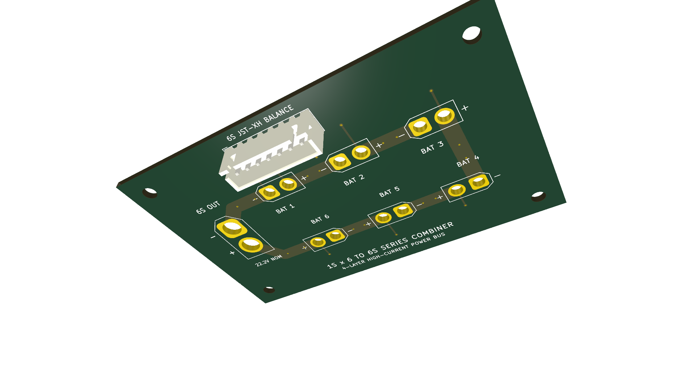
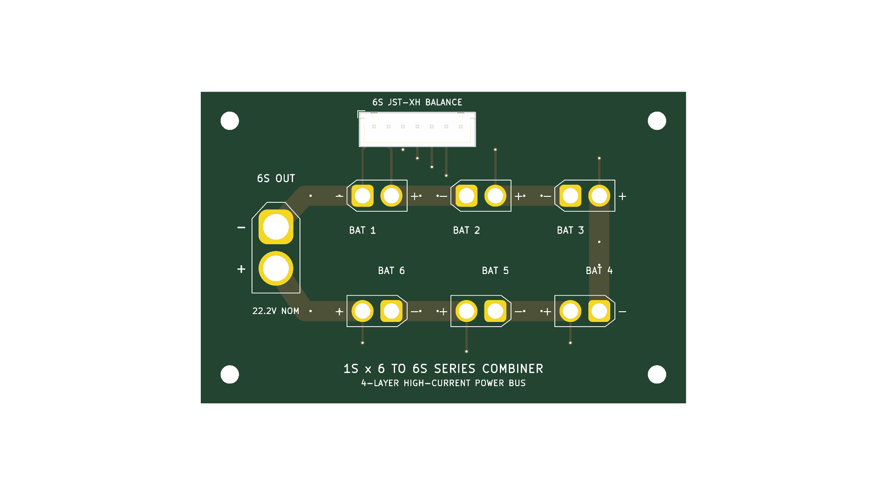
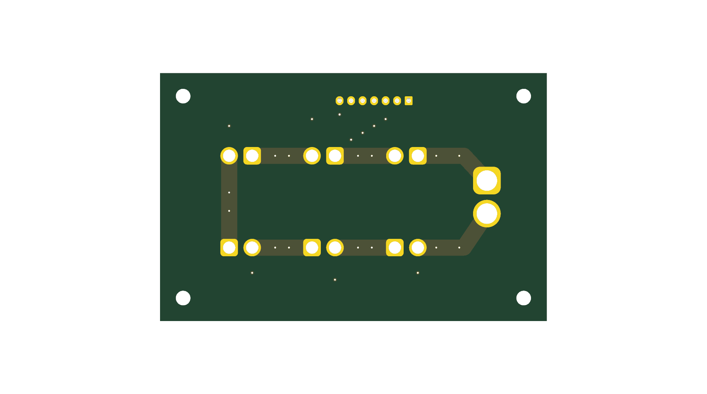

# 1S × 6 to 6S Series Battery Combiner PCB (v1.0)

A production-grade, 4-layer power distribution board designed to connect six individual 1S LiPo/Li-ion batteries in series to produce a single 6S battery output (22.2V nominal / 25.2V max).

## Overview & Specs
- **Inputs:** 6× AMASS XT30 Male vertical through-hole connectors (`J_BAT1` to `J_BAT6`).
- **Output:** 1× AMASS XT60 Female vertical high-current socket (`J_OUT`).
- **Balance Port:** 1× JST-XH 7-Pin 2.50mm vertical balance header (`J_BAL`) for cell monitoring & balance charging.
- **Layers:** 4-Layer FR-4 (1.6mm thickness, 1oz copper outer/inner).
- **Dimensions:** 84 mm × 54 mm with 4× M3 mounting holes.
- **Continuous Current Rating:** 32A continuous ($\Delta T < 10^\circ\text{C}$), up to 60A burst.

## Board Views
| Top View | Bottom View |
| :---: | :---: |
|  |  |

## High-Current Bus Design
- **Parallel Copper Buses:** 3.5mm wide traces on `F.Cu` and `B.Cu` in parallel (equivalent to 7.0mm / 275 mil total copper).
- **Layer Isolation:** Inner layers `In1.Cu` and `In2.Cu` carry shielded balance sense lines with zero planar crossing.
- **Via Stitching:** Array of 14 stitching vias (0.8mm size / 0.4mm drill) along high-current paths.

## Verification
- **KiCad DRC:** 0 Violations, 0 Unconnected Items.
- **KiCad ERC:** 0 Errors.

## Manufacturing & Ordering
The [`pcb_1s_to_6s_combiner_production_gerbers.zip`](pcb_1s_to_6s_combiner_production_gerbers.zip) archive contains standard RS-274X Gerber and Excellon drill files ready for instant ordering on **JLCPCB**, **PCBWay**, or **Seeed Studio**.
